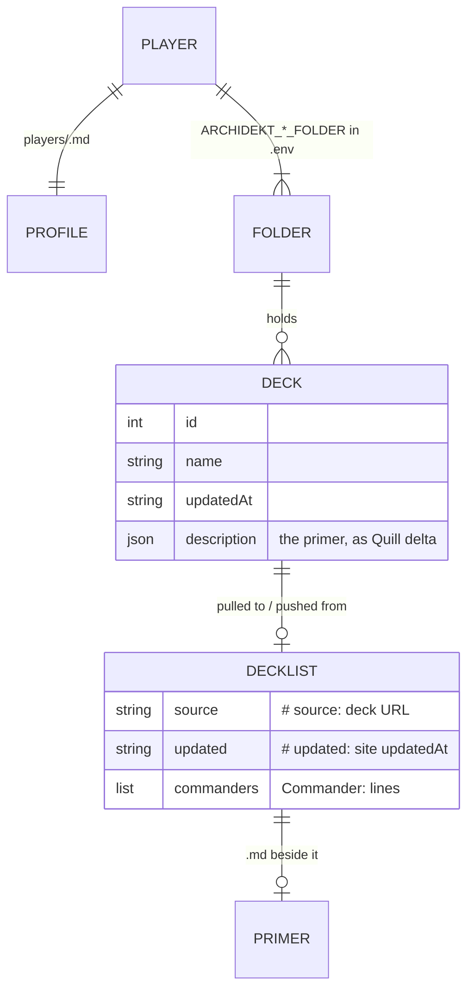
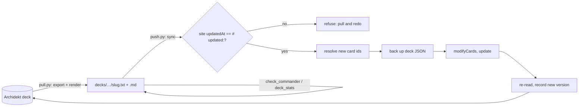

# Architecture

Python tools a playgroup uses, mostly through an AI agent, to build and tune Magic: The Gathering
decks (mostly Commander) on their own Archidekt accounts. Archidekt holds the decks; this repo holds
the tools, the house rules and one profile per player. It is not a deck archive, a web app or a
packaged library: scripts run from the repo root with the standard library only.

Verified against 8892047 on 2026-10-24.

## Codemap

- **`mtg/`**: one module per outside site, plus the formats they share.
  - `archidekt`: `login` (token cached in `~/.config/mtg/archidekt-session.json`), deck reads, `resolve` (card ids), `sync` (push), `export` (pull), `archive`.
  - `scryfall`: card data (`collection`, `color_identity`; `matching` runs one chunked "these names AND this query" search, behind `ub_only`, roles and `--pool`).
  - `cards`: card-name and card-dict basics every module shares (`front`, `oracle_text`, `is_land`; pure).
  - `edhrec`, `spellbook`, `moxfield`: recommendations, combos, reading Moxfield decks.
  - `roles`: card roles (ramp, draw, removal…) from Scryfall oracle tags, cached per card; `alternatives` finds other cards with a role.
  - `scores`: scores from EDHREC data and lists: hidden gems, staple share, overlap, synergy density (pure).
  - `goldfish`: mana maths and the goldfish simulation (pure).
  - `brackets`: the official WotC bracket, the house verdict, what makes a combo fast (pure).
  - `patterns`: what a card does to the table, from oracle-text regexes (MLD, extra turns…; pure).
  - `discovery`: underplayed commanders by mechanic, and challenge-deck rolls (Scryfall searches).
  - `profile`: the player profile format (`enjoys`, play-log `render_entry` / `add_entry`).
  - `forge`: our list to a Forge `.dck`, running Forge's headless `sim`, parsing its results.
  - `importdeck`: turns a link (Moxfield, Archidekt, MTGGoldfish, plain text, Instagram) into a deck.
  - `decklist`: the `.txt` list format (`parse`, `render`, `meta`, `set_meta`) and `BASICS` (snow and Wastes too).
  - `quill`: primer markdown ↔ Archidekt's Quill delta (`to_delta`, `from_delta`).
  - `config`: settings from the environment or `.env`; `CACHE` dir.
  - `http`: JSON requests with retry on HTTP 429.
- **`scripts/`**: the command line. Each script's docstring is its usage (`--help`).
- **`tests/`**: offline `unittest` suite; network fakes sit at each client (`archidekt.call`, `scryfall.search`,
  `edhrec._fetch`, `spellbook`'s `http.request`), trimmed real responses in `tests/fixtures/`.
- **`RULES.md`**: house rules for Commander decks (power target, card rules, list and primer format).
- **`players/`**: one profile per player (taste, preferences, play log).
- **`docs/apis.md`**: what we know about each site's API, private ones included; `docs/forge.md`: the Forge install and `sim` mode.
- **`.mcp.json`**: the j4th/mtg-mcp-server MCP server (pinned, read-only card search) for agents.
- **`.claude/skills/commander-deck/`**: the agent workflow for building, tuning and pushing decks.
- **`specs/`**: build plans; finished ones live in `specs/done/` as rationale records.
- **`decks/`** (gitignored): each player's local working copy of their Archidekt decks.

## Data model

Source of truth: Archidekt's deck JSON (see `docs/apis.md`); the local file format is owned by
`mtg/decklist.py`.

## Interfaces

**Deck sync (writes go to the player's Archidekt account):**
- `scripts/pull.py`: decks (ids, URLs, or a whole folder) to local lists and primers.
- `scripts/push.py`: local lists to their decks, creating new ones; `--dry-run` shows differences.
- `scripts/whoami.py`: who this checkout is set up for; checks the login.

**Building and checking (read-only):**
- `scripts/import_deck.py`: someone else's deck link to a local list.
- `scripts/edhrec_recs.py`: EDHREC recommendations and cut candidates for a commander or list; `--gems`.
- `scripts/originality.py`: staple share, overlap with the player's other decks, synergy density, odd swaps.
- `scripts/check_commander.py`: legality, colour identity, Game Changers, combos (Commander Spellbook), bracket (official, Spellbook, house).
- `scripts/table_feel.py`: how a deck feels to the other players (salt, table-touching cards) and a Rule 0 pitch.
- `scripts/deck_stats.py`: role counts, mana sources, a goldfish simulation.
- `scripts/discover.py`: commanders matching the player's taste, or a challenge deck and its pool.
- `scripts/forge_sim.py`: 2 to 4 of the player's decks played against each other by Forge's AI (rough win share).

**File formats:** the decklist `.txt` (header `# Name | COLOURS`, `# source:` / `# updated:` lines,
`Commander:` lines, `N Card` lines; full `A // B` names) and the primer `.md` (light markdown, see
`RULES.md`). **Settings:** `.env`, keys listed in `.env.example`.

No server, no package install, no CI.

## Features

**Archidekt as the deck store.** Pull writes each deck as a list plus primer, stamped with its
source and version. Push diffs the list against the site deck, resolves new card ids through the
site's own import parser, backs up the deck JSON, writes, re-reads to confirm, and records the new
version. It refuses when the site changed since the list's version. Starts in `archidekt.sync`;
rationale in [specs/done/archidekt-canonical](specs/done/archidekt-canonical/README.md).

**Deck building with an agent.** The `commander-deck` skill drives an agent through a build:
read the house rules and the player's profile, pull data (EDHREC, Scryfall), draft, check
(`check_commander.py`, `deck_stats.py`), write a primer, push. The profile's play log feeds back
into later builds.

**Fun-first checks and finders.** Beside legality, an agent checks how a deck will feel to the
table: the bracket line (official WotC bracket, Spellbook's tag, house verdict), `table_feel.py`
(salt, interaction, a Rule 0 pitch), `originality.py` (same-99 share, odd swaps) and a colour-aware
goldfish against Karsten's source table. `discover.py` finds underplayed commanders for the mechanics
the player enjoys or rolls a challenge deck; `edhrec_recs.py --gems` finds high-lift, rarely played
cards. Outside tools: an MCP server for card search (`.mcp.json`) and Forge AI pods
(`forge_sim.py`). Rationale in [specs/done/deck-tools](specs/done/deck-tools/README.md).

**Importing decks.** `importdeck.load` dispatches on the link; Instagram is a best-effort chain
(caption, link-in-bio pages, profile decks scored against the caption) that lists candidates rather
than guessing.

**A playgroup.** Each player has their own `.env` (account, folders, `MTG_PLAYER`) and profile; the
house rules are shared. A new player joins by opening a PR with their profile; `.env` stays
local. Linked git worktrees read the main checkout's `.env`.

## Flows

## Invariants and gotchas

- **Never print or read the Archidekt password**; `.env` stays gitignored. Local `refs/t3/*`
  checkpoints (made by the T3 Code app) contain `.env`: never `git push --all` or `--mirror`.
- **A push never overwrites unseen site edits.** The version lives in the list (`# updated:`), not
  on the machine, so two worktrees can't push over each other. Lists without it must be pulled first.
- **Archive, don't delete** decks on Archidekt (`archidekt.archive`); ask the player before any delete.
- **Rate limits:** Archidekt returns 429 quickly (about 1 request a second; resolve card ids in bulk),
  Scryfall wants under 10 a second with an `Accept` header, EDHREC about 1 a second (cached a week).
- **Use full `A // B` names** for double-faced and split cards: the site exports them, so a front-face
  name shows as a change on every push. `check_commander.py` flags it.
- **Primers are public:** written for any player, never mentioning our tools; card text checked
  against Scryfall oracle text.
- **Push leaves site structure alone:** Maybeboard, Sideboard and not-in-deck categories are skipped
  and existing cards keep their categories.
- **Nothing from Mulligan Labs game history goes in this public repo** (friends' names, commanders,
  replays). The post-game report and playgroup meta live in the private `~/Projects/mtg-table`, which
  imports `mtg`; only a play-log entry the player confirms crosses back.
- **Fresh worktrees have no decks**: `decks/` is gitignored, so pull first.
- **Caches and backups** live in `~/.cache/mtg` (`config.CACHE`), shared by every checkout.
- **Logic lives in `mtg/`, scripts parse arguments and print.** The pure modules (`cards`, `patterns`,
  `brackets`, `scores`, `goldfish`) never import `http`: callers fetch and pass the data in, so tests need no fakes.

## Where to start

- **Archidekt changed its API:** `mtg/archidekt.py` and `docs/apis.md` (how endpoints were found).
- **A new check on deck lists:** the logic in a pure module (`mtg/brackets.py` for rules and brackets,
  `mtg/patterns.py` for what cards do, `mtg/scores.py` for numbers), printed by `scripts/check_commander.py`
  (rule breaks), `scripts/table_feel.py` (table feel) or `scripts/deck_stats.py` (roles, mana, goldfish).
- **Tune what discovery looks for:** `discovery.MECHANICS` and `KEYWORDS` in `mtg/discovery.py`.
- **Change the list format:** `mtg/decklist.py`, then `tests/test_decklist.py`.
- **Change how agents build decks:** `.claude/skills/commander-deck/SKILL.md` and `RULES.md`.
- **Import from a new site:** `mtg/importdeck.py` (`load` dispatch) and `docs/apis.md`.
