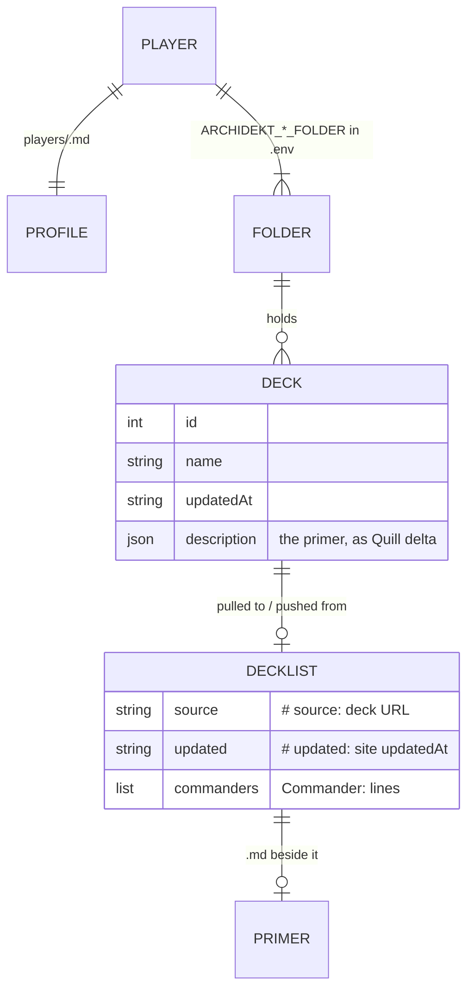
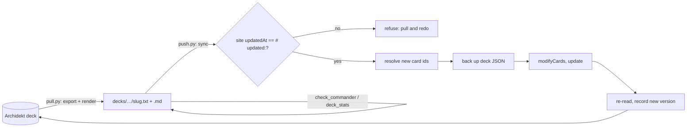

# Architecture

Python tools a playgroup uses, mostly through an AI agent, to build and tune Magic: The Gathering
decks (mostly Commander) on their own Archidekt accounts. Archidekt holds the decks; this repo holds
the tools, the house rules and one profile per player. It is not a deck archive, a web app or a
packaged library: scripts run from the repo root with the standard library only.

Verified against fd3c976 on 2026-10-20.

## Codemap

- **`mtg/`**: one module per outside site, plus the formats they share.
  - `archidekt`: `login` (token cached in `~/.config/mtg/archidekt-session.json`), deck reads, `resolve` (card ids), `sync` (push), `export` (pull), `archive`.
  - `scryfall`: card data (`collection`, `oracle_text`, `color_identity`, `ub_only`).
  - `edhrec`, `spellbook`, `moxfield`: recommendations, combos, reading Moxfield decks.
  - `roles`: card roles (ramp, draw, removal…) from Scryfall oracle tags, cached per card.
  - `goldfish`: mana maths and the goldfish simulation (pure).
  - `brackets`: bracket rules, starting with what makes a combo fast (pure).
  - `discovery`: underplayed commanders by mechanic, and challenge-deck rolls (Scryfall searches).
  - `profile`: the player profile format (`enjoys`).
  - `importdeck`: turns a link (Moxfield, Archidekt, MTGGoldfish, plain text, Instagram) into a deck.
  - `decklist`: the `.txt` list format (`parse`, `render`, `meta`, `set_meta`).
  - `quill`: primer markdown ↔ Archidekt's Quill delta (`to_delta`, `from_delta`).
  - `config`: settings from the environment or `.env`; `CACHE` dir.
  - `http`: JSON requests with retry on HTTP 429.
- **`scripts/`**: the command line. Each script's docstring is its usage (`--help`).
- **`tests/`**: offline `unittest` suite; fakes sit at `archidekt.call` and `archidekt.resolve`.
- **`RULES.md`**: house rules for Commander decks (power target, card rules, list and primer format).
- **`players/`**: one profile per player (taste, preferences, play log).
- **`docs/apis.md`**: what we know about each site's API, private ones included.
- **`.claude/skills/commander-deck/`**: the agent workflow for building, tuning and pushing decks.
- **`specs/`**: build plans; finished ones live in `specs/done/` as rationale records.
- **`decks/`** (gitignored): each player's local working copy of their Archidekt decks.

## Data model

Source of truth: Archidekt's deck JSON (see `docs/apis.md`); the local file format is owned by
`mtg/decklist.py`.

## Interfaces

**Deck sync (writes go to the player's Archidekt account):**
- `scripts/pull.py`: decks (ids, URLs, or a whole folder) to local lists and primers.
- `scripts/push.py`: local lists to their decks, creating new ones; `--dry-run` shows differences.
- `scripts/whoami.py`: who this checkout is set up for; checks the login.

**Building and checking (read-only):**
- `scripts/import_deck.py`: someone else's deck link to a local list.
- `scripts/edhrec_recs.py`: EDHREC recommendations and cut candidates for a commander or list.
- `scripts/check_commander.py`: legality, colour identity, Game Changers, combos (Commander Spellbook).
- `scripts/deck_stats.py`: role counts, mana sources, a goldfish simulation.
- `scripts/discover.py`: commanders matching the player's taste, or a challenge deck and its pool.

**File formats:** the decklist `.txt` (header `# Name | COLOURS`, `# source:` / `# updated:` lines,
`Commander:` lines, `N Card` lines; full `A // B` names) and the primer `.md` (light markdown, see
`RULES.md`). **Settings:** `.env`, keys listed in `.env.example`.

No server, no package install, no CI.

## Features

**Archidekt as the deck store.** Pull writes each deck as a list plus primer, stamped with its
source and version. Push diffs the list against the site deck, resolves new card ids through the
site's own import parser, backs up the deck JSON, writes, re-reads to confirm, and records the new
version. It refuses when the site changed since the list's version. Starts in `archidekt.sync`;
rationale in [specs/done/archidekt-canonical](specs/done/archidekt-canonical/README.md).

**Deck building with an agent.** The `commander-deck` skill drives an agent through a build:
read the house rules and the player's profile, pull data (EDHREC, Scryfall), draft, check
(`check_commander.py`, `deck_stats.py`), write a primer, push. The profile's play log feeds back
into later builds.

**Importing decks.** `importdeck.load` dispatches on the link; Instagram is a best-effort chain
(caption, link-in-bio pages, profile decks scored against the caption) that lists candidates rather
than guessing.

**A playgroup.** Each player has their own `.env` (account, folders, `MTG_PLAYER`) and profile; the
house rules are shared. A new player joins by opening a PR with their profile; `.env` stays
local. Linked git worktrees read the main checkout's `.env`.

## Flows

## Invariants and gotchas

- **Never print or read the Archidekt password**; `.env` stays gitignored. Local `refs/t3/*`
  checkpoints (made by the T3 Code app) contain `.env`: never `git push --all` or `--mirror`.
- **A push never overwrites unseen site edits.** The version lives in the list (`# updated:`), not
  on the machine, so two worktrees can't push over each other. Lists without it must be pulled first.
- **Archive, don't delete** decks on Archidekt (`archidekt.archive`); ask the player before any delete.
- **Rate limits:** Archidekt returns 429 quickly (about 1 request a second; resolve card ids in bulk),
  Scryfall wants under 10 a second with an `Accept` header, EDHREC about 1 a second (cached a week).
- **Use full `A // B` names** for double-faced and split cards: the site exports them, so a front-face
  name shows as a change on every push. `check_commander.py` flags it.
- **Primers are public:** written for any player, never mentioning our tools; card text checked
  against Scryfall oracle text.
- **Push leaves site structure alone:** Maybeboard, Sideboard and not-in-deck categories are skipped
  and existing cards keep their categories.
- **Fresh worktrees have no decks**: `decks/` is gitignored, so pull first.
- **Caches and backups** live in `~/.cache/mtg` (`config.CACHE`), shared by every checkout.

## Where to start

- **Archidekt changed its API:** `mtg/archidekt.py` and `docs/apis.md` (how endpoints were found).
- **A new check on deck lists:** `scripts/check_commander.py` (rules) or `scripts/deck_stats.py` (numbers).
- **Change the list format:** `mtg/decklist.py`, then `tests/test_decklist.py`.
- **Change how agents build decks:** `.claude/skills/commander-deck/SKILL.md` and `RULES.md`.
- **Import from a new site:** `mtg/importdeck.py` (`load` dispatch) and `docs/apis.md`.
